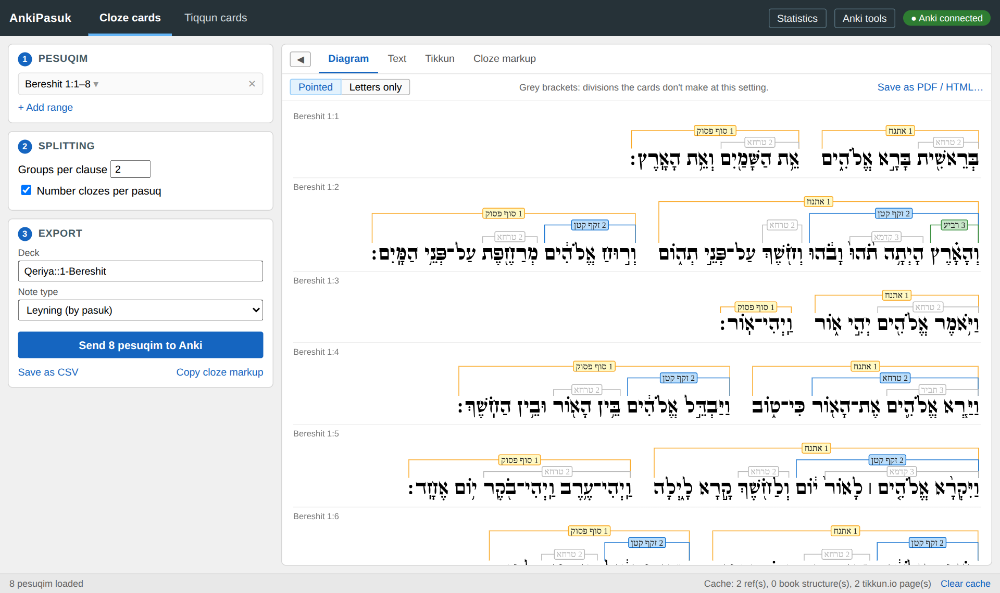
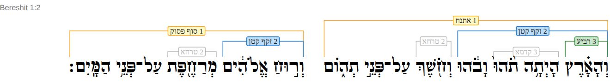
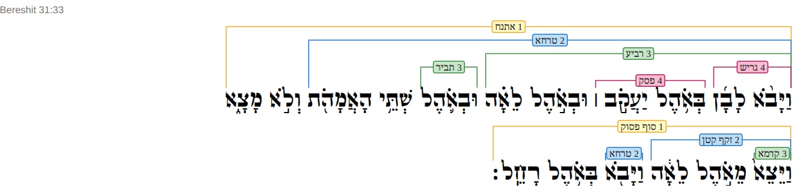
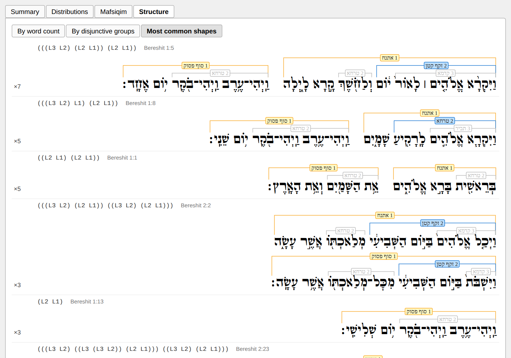
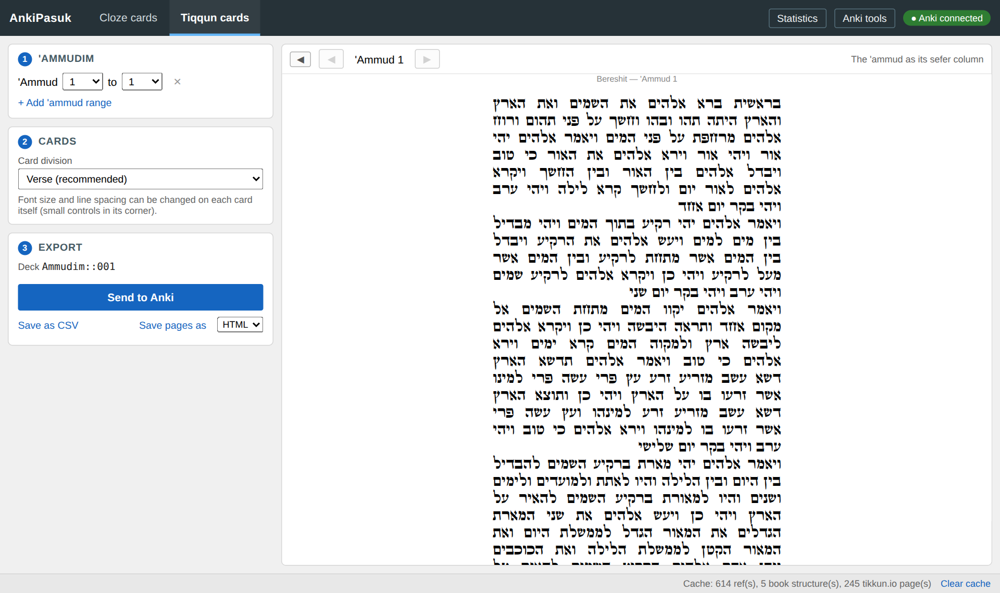

# AnkiPasuk

AnkiPasuk makes [Anki](https://apps.ankiweb.net/) cards for learning to read
from the sefer. It takes the text and ta'amim from
[Sefaria](https://www.sefaria.org/) and gives you two kinds of cards, each
with its own job:

- **Cloze cards** are for learning the pesuqim and their structure. Each
  pasuq is taken apart along its own ta'amim: first into its two halves,
  then each half into its clauses, down to the smallest phrases the
  mafsiqim allow. You learn the reading a piece at a time and see how the
  ta'amim divide the pasuq as you go. The hidden part shows only its bare
  letters, the way it's written in the sefer, and you supply the reading.
- **Tiqqun cards** are for memorizing what you'll actually read: an
  'ammud at a time, line by line, laid out as in the sefer (the standard
  layout of 245 'ammudim with 42 lines each). The cloze cards teach you the
  pesuqim; these make sure you can read them off the column in front of
  you.

Every pasuq is drawn the way Joshua Jacobson draws them in *Chanting the
Hebrew Bible*: a bracket over the text each mafsiq closes, ranked and
coloured, so you can see the whole division at a glance.



There's also a statistics window for whatever you've loaded, including a
way to find pesuqim that share the same ta'amim structure, and a few
optional tools that work on your Anki collection directly.

## Contents

- [Installing](#installing)
- [Using the app](#using-the-app)
- [How the cloze cards are made](#how-the-cloze-cards-are-made)
- [The diagram](#the-diagram)
- [Shorashim](#shorashim)
- [Statistics](#statistics)
- [Tiqqun cards](#tiqqun-cards)
- [Haftarot](#haftarot)
- [Tools that work on your Anki collection](#tools-that-work-on-your-anki-collection-optional)
- [Spelling](#spelling) · [Cache](#cache) · [For developers](#for-developers) · [Credits](#credits)

## Installing

You need Python 3.10 or newer.

```bash
git clone https://github.com/bjoraz/ankipasuk.git
cd ankipasuk
python3 -m venv .venv
source .venv/bin/activate        # Windows: .venv\Scripts\activate
pip install -e .
ankipasuk
```

To update, run `git pull` in the checkout. The install is editable (`-e`),
so it runs the code in the checkout and picks up changes without
reinstalling.

The window uses [pywebview](https://pywebview.flowrl.com/), which draws
with the system's own web engine (WebView2 on Windows, WKWebView on
macOS), so nothing else is needed there.

### Linux

pywebview needs WebKitGTK or Qt WebEngine. WebKitGTK is the one your
desktop already uses. Install its system packages, and create the venv
with `--system-site-packages` so it can see them:

```bash
sudo apt install python3-gi gir1.2-webkit2-4.1 libwebkit2gtk-4.1-0  # Debian/Ubuntu
sudo dnf install python3-gobject webkit2gtk4.1                      # Fedora
sudo pacman -S python-gobject webkit2gtk-4.1                        # Arch
sudo zypper install python3-gobject typelib-1_0-WebKit2-4_1         # openSUSE

python3 -m venv --system-site-packages .venv
```

Then continue as above. With pipx: `pipx install --editable --system-site-packages .`

Qt WebEngine installs from pip instead, without root but about 100 MB:
`pip install -e ".[qt]"`. It needs the system's EGL and OpenGL libraries,
which minimal installs can lack (`libegl1 libgl1` on Debian/Ubuntu).

If neither works, `ankipasuk` says what to install. `PYWEBVIEW_GUI=gtk`
or `PYWEBVIEW_GUI=qt` forces one.

### Optional extras

- **PDF** (of the diagrams, or of 'ammudim as pages) needs WeasyPrint:
  `pip install -e ".[pdf]"`, or with pipx `pipx inject ankipasuk
  weasyprint`. It draws text with Pango, which Linux desktops have; on
  Windows it needs a GTK runtime. HTML export needs nothing extra.
- **Sending cards straight to Anki**, and the collection tools, need Anki
  open with the [AnkiConnect](https://ankiweb.net/shared/info/2055492159)
  add-on. Without it you can still save CSV files to import.
- The old Tk interface (`ankipasuk-tk-legacy`) needs tkinter (`python3-tk`
  on Debian/Ubuntu). It isn't maintained any more.

## Using the app

The window has a tab for each kind of card, **Cloze cards** and **Tiqqun
cards**. Each has its settings on the left, in three numbered steps, and a
preview on the right that follows them as you go: there's nothing to fetch
or generate by hand. The bar at the top also opens **Statistics** and
**Anki tools**, and shows whether Anki is open with AnkiConnect, which
sending cards needs. The note types are loaded as soon as it is. The ◀
at the top of the preview folds the settings away, to see the preview on
its own across the whole window; **▶ Settings** brings them back, and the
app remembers which you left it on.

### The Cloze cards tab

1. **Pesuqim.** Add one or more ranges, by chapter and verse, by parasha
   and 'aliyya, or by haftara, from the Tora, Nevi'im or the five
   Megillot. Each range is one line, e.g. `Bereshit 1:1–2:3` or
   `Noaḥ 6 – Lekh Lekha 2`; click it to change it, ✕ to remove it. A
   range by parasha and 'aliyya runs from one 'aliyya to another, in the
   same parasha or a later one of the same book; a new one is a single
   'aliyya. A range's end can't come before its start: the end pickers
   start where the start is. Ranges are joined in the order you add them,
   so you can run the end of one book into the start of the next.
2. **Splitting.** **Groups per clause** (*N* below, default 2) is how many
   disjunctive groups a clause may keep before it's split again along its
   ta'amim. Lower means more, smaller clauses; 1 gives the complete
   division. **Number clozes per pasuq** is on by default, so each pasuq
   starts again at c1 and becomes its own note; turn it off to keep
   counting across the whole range.
3. **Export** the notes, one per pasuq:
   - **Send to Anki**, with Anki open. Pick a deck (one is suggested from
     what you loaded: the book's `Qeriya::` deck, or `Qeriya::Haftarot`)
     and a note type whose fields start with Number, Source, Text, Verse,
     Previous, Next, Back Extra and a settings field (the CSV's layout).
     The deck is created if it's missing. Only pesuqim that don't have a
     note yet are added. Existing notes, with their scheduling and anything
     you added to them (a recording, say), are never changed.
   - **Save as CSV**, then import the file into Anki. It's tab-separated:
     the pasuq's number (its place in the book, or in the haftara), the
     reference (e.g. `Bereshit 1:1`), the cloze text, the unpointed pasuq,
     the unpointed pesuqim before and after it, an empty column, a fixed
     settings string, and the tags. A header line tells Anki which column
     holds the tags.

   Either way each note gets its tags: the parasha, 'aliyya and holiday
   tags for the Tora, and `haftara::<parasha>` for a haftara. The tagging
   tool looks for the reference in a field called `Source`.

The preview has four views:

- **Diagram**: each pasuq drawn as its division (see [The diagram](#the-diagram)).
- **Text**: the pesuqim pointed or as bare letters, with a Copy button.
  Click a word to colour every word of its shoresh, with the passage's
  shorashim listed beside the text (see [Shorashim](#shorashim)).
- **Tikkun**: the pesuqim as they're laid out in the sefer, pointed or not,
  with controls for text size, line spacing and width.
- **Cloze markup**: exactly what goes into Anki, to copy.

A whole book loads quickly: pesuqim are drawn only as they scroll into
view.

**Save as PDF / HTML…**, in the Diagram view, saves every loaded pasuq's
diagram as pages, to read from or print. It opens a preview of the pages,
redrawn as you change the options beside it:

- **Diagram:** text size, bracket spacing, labels (rank and name, name
  only, rank only, or none) and their size, whether to draw the grey
  brackets, and black and white.
- **Page:** A4 or Letter, portrait or landscape, margins, the space
  between pesuqim, and whether to show the references, the lines between
  pesuqim, and the title and legend.

The preview shows the first dozen pesuqim, with the page breaks where the
PDF will have them (a pasuq is never split across pages), and the app
remembers your options. A half too wide for the page is set in smaller
text. The HTML carries the font inside it and needs no script, so it
opens and prints anywhere. A PDF of a whole book takes a few minutes
(Bereshit at the default settings: 279 pages, about 4½ minutes).

### The Tiqqun cards tab

The same layout: the 'ammudim, how to divide their cards, and the export
on the left; on the right, each chosen 'ammud as its column of the sefer,
with ◀ ▶ to step through them. See [Tiqqun cards](#tiqqun-cards) below.

## How the cloze cards are made

Here it is step by step, with Bereshit 1:2 as the example.

### 1. Rank each word by its ta'am

Every mafsiq has a rank, following the usual four classes (qesarim,
melakhim, mishnim, shalishim):

| Rank | Ta'amim |
|---|---|
| 1 | Sof pasuq, Atnaḥ |
| 2 | Segolta, Shalshelet, Zaqef qaton, Zaqef gadol, Tarḥa |
| 3 | Ravia', Qadma, Zarqa, Yetiv, Tevir |
| 4 | Gerish, Shene gerishin, Pazer gadol, Talsha, Paseq |
| 0 | the mesharetim: Shofar holekh, Ma'arikh, Shofar mehuppakh, Azla, Darga, Tarsa |

A word takes the rank of the strongest ta'am on it. Tere qadmin, the
qadma written twice on a word whose stress isn't on its last syllable, is
the same ta'am and counts as qadma.

The vertical stroke after a shofar holekh needs one extra rule, since the
same sign can be part of a mafsiq or just a pause:

| Shofar holekh + stroke | Read as | Rank | Ashkenazi name |
|---|---|---|---|
| next mafsiq is rank 3 | paseq, a mafsiq | 4 | munach legarmeh |
| anywhere else | a mesharet with a pause | 0 | munach pasek |

The next mafsiq is usually a ravia', but any rank-3 mafsiq counts. That
follows Jacobson, who has rare cases before the other rank-3 ta'amim. In
the code the plain stroke is labeled "Pesiq" to keep it apart from paseq.
That label is AnkiPasuk's own, not an established Sephardi term, and it's
never shown in the app.

The names follow the table in Wikipedia's
[Hebrew cantillation](https://en.wikipedia.org/wiki/Hebrew_cantillation)
article. If you work with the Unicode characters directly, go by the
codepoint rather than Unicode's character name, which often differs: Qadma
here is U+0599 (Unicode calls it PASHTA), Azla is U+05A8 (Unicode's QADMA),
Atnaḥ is U+0591 (ETNAHTA), and so on. In tere qadmin the extra mark on the
stressed syllable is also written U+05A8; that isn't an azla, and the word
counts as qadma. Unicode also has the names of zarqa and tsinnorit the
wrong way round: zarqa is U+05AE (named ZINOR) and
tsinnorit is U+0598 (named ZARQA). Sefaria's text uses that encoding, and so
does AnkiPasuk. `TROPE_UNICODE` in `config.py` has the full mapping.

### 2. Group mesharetim with the mafsiq they lead into

Each run of mesharetim joins the mafsiq that ends it. These groups are the
smallest units the ta'amim let you cut the pasuq into. Bereshit 1:2 has
eight:

| | Group | Ends with | Rank |
|---|---|---|---|
| 1 | וְהָאָ֗רֶץ | Ravia' | 3 |
| 2 | הָיְתָ֥ה תֹ֨הוּ֙ | Tere qadmin | 3 |
| 3 | וָבֹ֔הוּ | Zaqef qaton | 2 |
| 4 | וְחֹ֖שֶׁךְ | Tarḥa | 2 |
| 5 | עַל־פְּנֵ֣י תְה֑וֹם | Atnaḥ | 1 |
| 6 | וְר֣וּחַ אֱלֹהִ֔ים | Zaqef qaton | 2 |
| 7 | מְרַחֶ֖פֶת | Tarḥa | 2 |
| 8 | עַל־פְּנֵ֥י הַמָּֽיִם׃ | Sof pasuq | 1 |

### 3. Split, then split again

Within any stretch of text, find the strongest mafsiq other than the one
that closes the stretch, and cut right after it. If that rank shows up more
than once, cut after the first one, since the earlier of two equal
mafsiqim is the bigger pause. Then do the same to each half.

You stop when a piece has at most *N* groups left (**Groups per clause**).
With *N* = 1 you get the complete division, down to single groups. A
higher *N* leaves longer phrases intact and gives you fewer, harder cards.

For Bereshit 1:2 the atnaḥ on תְה֑וֹם splits the pasuq. In the first half,
the zaqef on וָבֹ֔הוּ outranks the tarḥa after it. In the piece before
that, ravia' and tere qadmin are both rank 3, so the cut comes after the
ravia'. The second half splits at the zaqef on אֱלֹהִ֔ים. This is what the
app draws for it at *N* = 2:



The coloured brackets are the cuts the cards make. The grey ones (the two
tarḥas, the qadma of the tere qadmin) are the finer division that *N* = 2
leaves inside its clauses.

### 4. Turn the tree into clozes

Every piece of the tree, at every level, becomes its own cloze. They're
numbered children first, so the smallest clauses get the low numbers and
the whole pasuq is always the last one. A pasuq cut into *k* clauses gets
2*k* − 1 clozes: Bereshit 1:2, in five clauses, gives nine cards:

```
c9  והארץ היתה תהו ובהו וחשך על פני תהום ורוח אלהים מרחפת על פני המים
c5  ├─ והארץ היתה תהו ובהו וחשך על פני תהום
c3  │  ├─ והארץ היתה תהו ובהו
c1  │  │  ├─ והארץ
c2  │  │  └─ היתה תהו ובהו
c4  │  └─ וחשך על פני תהום
c8  └─ ורוח אלהים מרחפת על פני המים
c6     ├─ ורוח אלהים
c7     └─ מרחפת על פני המים
```

Each cloze is written as `{{cN::pointed text::unpointed text}}`, so the
hint Anki shows in the gap is the same words without niqqud or ta'amim,
just as they look in the sefer. On card c1 you see the rest of the pasuq
fully pointed and have to read וְהָאָ֗רֶץ from its letters. On c9 you get
the letters of the whole pasuq and nothing else. Nested clozes need Anki
2.1.56 or newer.

Tehillim, Mishle and Iyov aren't supported, because the Sifre Emet use a
different system of ta'amim.

## The diagram

Each pasuq's division is drawn after Joshua Jacobson's diagrams. Above the
pointed text, each mafsiq has a bracket over the stretch of text it
closes, labelled with its rank and Hebrew name, one colour per rank:

| Rank | Colour |
|---|---|
| 1 | yellow |
| 2 | blue |
| 3 | green |
| 4 | pink |

As in his diagrams, each division sits a row below the one it divides, so
1 אתנח and 1 סוף פסוק are on top. A "downgraded" mafsiq, one that only
divides what's left after an earlier one of the same rank, sits lower than
that one. Bereshit 31:33, Jacobson's own example, at *N* = 1:



The tevir divides only what's left after the ravia', so it's drawn a row
below it. The atnaḥ half and the sof pasuq half are separate units, side
by side on their text line when they fit and one under the other when
they don't. A unit still too wide for the window scrolls sideways, with
the mouse wheel too.

The diagram always shows the complete division; brackets in grey are the
divisions the cards don't make at the current *N*, so you can see where a
card's clauses stop. Pasuq text everywhere in the app is in the same STAM
font as the tiqqun.

## Shorashim

Every word of the Tora, the Nevi'im and the Megillot has its shoresh:

- A word goes under its root, with all the words BDB files under it:
  רֵאשִׁית and רֹאשׁ under ר־א־שׁ, מָקוֹם under ק־ו־מ, תּוֹלְדוֹת and
  יֶלֶד under י־ל־ד.
- A particle (אֵת, אֲשֶׁר, כִּי, עַל, the pronouns, ...), a name, or a
  word with no root in BDB is itself, in all its forms. That includes
  words with a prefix or suffix, like וְאֵת or לָכֶם.

In the **Text** view, click a word: every word with its shoresh in the
passage gets a colour. Click another, and its shoresh gets the next
colour; click a coloured word again to take its colour off, or **Clear
colours** for all. The colours go in the order you click, from 20 chosen
to be told apart easily (Sasha Trubetskoy's), each taking the first colour
no coloured shoresh has, and round again once all twenty are in use.

Beside the text is the passage's list of shorashim, the most frequent
first, each with a short gloss and how often it occurs. Clicking one
colours it just like clicking a word, and a coloured shoresh is coloured
in the list too. Particles are left out of the list unless you tick
**particles** (they're still coloured when you click them in the text).
The statistics window has the full table.

The roots come from the [Open Scriptures Hebrew Bible](https://github.com/openscriptures/morphhb),
which gives every word of the Leningrad Codex its lemma, and its
[lexicon](https://github.com/openscriptures/HebrewLexicon), which places
each lemma in Brown–Driver–Briggs (BDB) under its root. The glosses are
BDB's too: a shoresh is glossed by its commonest word (כ־ל־ל: "all", for
כֹּל). BDB's first words are sometimes an etymology rather than a meaning
(הָיָה "fall out", קֹדֶשׁ "apartness", אַחַר "the hinder"), so for the
commonest words the app gives the plain meaning instead ("be",
"holiness", "after"); the list is `GLOSS_FIXES` in `shorashim_build.py`.
Hovering a
shoresh in the list shows its words and their glosses. The data is
bundled with the app, so nothing is looked up as you go.

The app shows Sefaria's text, so each pasuq's words are lined up with
OSHB's: word by word where both have the same words (nearly every pasuq;
a spelling difference between the two codices, like הטהרה and הטהורה,
doesn't matter), ketiv and qere included, and by their letters
otherwise. Where the two divide a chapter into pesuqim
differently, as in the Ten Commandments, the whole chapter is lined up
at once. Of the 232,222 words the app can load, 100 (0.04%) end up with
no shoresh and simply aren't clickable.

## Statistics

**Statistics** opens a window on whatever is loaded, at your current *N*.
Click any bar or row to see the pesuqim behind it, each drawn as its
diagram. There's also a per-pasuq CSV export.

- **Summary**: the totals and averages.
- **Distributions**: words per pasuq, disjunctive groups per pasuq,
  clauses per pasuq (each pasuq's clozes are twice that, less one), how
  deep the split goes, and words per group, in bins of 0.1.
- **Mafsiqim**: how often each mafsiq occurs, by rank, in the diagrams'
  Hebrew names and colours.
- **Structure**: the pesuqim grouped by their shape (below).
- **Shorashim**: every shoresh in the loaded pesuqim (see above), the most
  frequent first, with its gloss and how many times it occurs, in how many
  pesuqim. Particles and names can be shown or hidden. Click a row to see
  its pesuqim, with its words highlighted.

### Pesuqim with the same shape

Run the split with *N* = 1 and replace each leaf with the rank of the
mafsiq that closes it. What's left is a signature of the pasuq's structure
that can be compared across pesuqim:

- Bereshit 1:1: `((L2 L1) (L2 L1))`
- Bereshit 1:2: `(((L3 (L3 L2)) (L2 L1)) (L2 (L2 L1)))`

The **Structure** tab groups every pasuq you've loaded by this signature:
by word count, by number of groups, or just the most common shapes first.
Each shape is written out with how many pesuqim share it and the diagram
of the first of them; click it to see them all. It's a quick way to see
which patterns keep coming back in a parasha you're preparing, or to
practise one awkward pattern across several pesuqim. The signature is
independent of whatever *N* you use for your cards.



## Tiqqun cards

Tiqqun cards are for memorizing the qeriya itself, an 'ammud at a time.
In the **Tiqqun cards** tab, choose one or more ranges of 'ammudim (1 to
245), and AnkiPasuk sends their cards straight to Anki, or saves them as
one CSV to import. Each 'ammud has its own deck, `Ammudim::001` to
`Ammudim::245`, so there's no deck to choose.



Every card is drawn from [tikkun.io](https://github.com/akivajgordon/tikkun.io)'s
layout data, which follows the standard layout of the sefer: 245 'ammudim
of 42 lines each. Lines break where they do in that layout and are
justified edge to edge, petuḥot and setumot appear as real gaps
(Az Yashir and the 'Aseret haDibberot included), and the font is the same
Shlomo semiStam that tikkun.io uses. The font is copied into Anki's media
folder, so the cards work offline.

You can divide the cards two ways:

**By pasuq** (the default). One card per pasuq, showing the line before it
for context and asking for the pasuq's own lines. Pesuqim rarely start and
end on a line break, and tikkun.io's data doesn't say where in a line one
pasuq stops and the next starts. AnkiPasuk works it out by lining up the
words on each line against Sefaria's word count for each pasuq, so every
card tests that pasuq's words and nothing more:

- On a line shared with the previous pasuq, its end is shown as ordinary
  text.
- On a line shared with the next pasuq, its opening words are covered by a
  gray bar on both sides of the card, so this card doesn't give away the
  next one.
- A pasuq that runs over onto the next 'ammud gets a visible "['Ammud N]"
  divider where the column changes.
- On the answer side, hovering a word (tapping it, on a phone) turns it,
  in place, into the same word with its niqqud and ta'amim; a ketiv shows
  its qere, in braces. The next pasuq's covered words don't.

The alignment also works backwards. If the first pasuq you asked for starts
in the middle of a line, it steps back to the last petuḥa (the last point
where nothing earlier can spill onto the line) and aligns from there, so a
stray word from before your range can't throw off every card after it.

Each card is titled by its pasuq (`Bereshit 1:3`); its 'ammud is in its
tags and deck.

**By line.** The overlapping-window method from the
[AnkiLPCG](https://github.com/sobjornstad/AnkiLPCG) add-on: a few lines of
context, then recite the next line (or lines). Context size, recite size
and grouping can all be set. This is an independent reimplementation; you
don't need AnkiLPCG installed.

Both kinds use the same note type, "Ankipasuk Aliyah", which is created the
first time you send cards to Anki (so do that once before importing a
CSV). As with the cloze cards, the deck is created if it's missing, and a
card that's already in Anki is skipped, wherever it is: the same pasuq's
card, or in line mode the same lines. Existing cards are never changed. A
pasuq's card is tagged with its parasha, 'aliyya and holidays like the
cloze notes, plus `ammud::NNN`. Each card has small controls in the corner
for text size, line spacing and width (A−/A+, ≡−/≡+, ↔−/↔+). Whatever you
set there applies to every card.

**Save pages as** HTML or PDF saves the chosen 'ammudim as pages instead:
each 'ammud as its column of the sefer, one to a page, in the same font,
blank lines between books included, to read from or print. It's the page
the tab previews. The HTML carries the font inside it and prints a page per
'ammud from a browser; PDF needs WeasyPrint (see
[Optional extras](#optional-extras)).

## Haftarot

Choose **Haftara** as a range's mode to load a parasha's haftara, or that
of a special Shabbat: the four parashiyyot, Shabbat haGadol, Ḥol haMo'ed
Sukkot and Pesaḥ, Rosh Ḥodesh, Maḥar Ḥodesh, and the two Shabbatot of
Ḥanukka. The list follows the Spanish and Portuguese custom, from the S&P
London list of readings; it's in `src/ankipasuk/data/haftarot.json`,
together with that list's rules for which haftara gives way to which. A
haftara in two parts (Mishpatim, Tsav, Mase, Shabbat Shuva) loads in
reading order.

A pasuq read in more than one haftara gets every one's tag: Yirmeyahu 1
is read for Shemot and for Mattot, Yesha'yahu 54:1–10 for Noaḥ and for Ki
Tetse.

## Tools that work on your Anki collection (optional)

These need Anki open with AnkiConnect. Open them from **Anki tools** in
the app, run them as commands (`ankipasuk-check-connection`,
`ankipasuk-init-stems`, `ankipasuk-sync-scheduling`, `ankipasuk-tag-deck`,
`ankipasuk-migrate-tags`), or double-click the scripts in `scripts/`.

- **Retire clause cards once you know the pasuq.** After a one-time step
  that flags each note's full-pasuq card, a sync suspends the clause cards
  on any note whose full-pasuq interval has reached 21 days (you can change
  this). If the full pasuq lapses, they're unsuspended and marked Again,
  so you drill them alongside it until it's back up. Details in
  [`docs/anki-scheduling.md`](docs/anki-scheduling.md).
- **Tag notes by where they're read.** Each note is tagged with its parasha
  and 'aliyya, whether it's in the maftir, and any holiday or fast-day
  reading it belongs to, for example `aliyya::bereshit::04-vayyera::7` and
  `holiday::rosh_hashana_ii::1`; a haftara pasuq gets `haftara::<parasha>`.
  It only ever adds tags. If an existing tag disagrees with what it worked
  out, that's reported and left alone. Details in
  [`docs/anki-tagging.md`](docs/anki-tagging.md).
- **Move old tags to the new spelling.** Decks tagged by earlier versions
  use the old spelling (`aliyah::...`, `holiday::simchat_torah::1`,
  `amud::012`). Migrate Tags renames those, and only those.

Every tool has a dry-run mode. Use it first.

## Spelling

Every Hebrew word AnkiPasuk shows or writes follows one set of rules: in
the app, on cards, in the book name it puts in a note's `Source` field, and
in tags. The rules, and the full list of book, parasha and holiday names
they produce, are in [`docs/transliteration.md`](docs/transliteration.md).

## Cache

Nothing is downloaded twice. Sefaria text, parasha divisions, and
tikkun.io's pages and font are all kept on disk:

- Linux and macOS: `~/.cache/ankipasuk/` (or `$XDG_CACHE_HOME/ankipasuk/`)
- Windows: `%APPDATA%\AnkiPasuk\`
- Anywhere else, if you set `ANKIPASUK_CACHE_DIR`

**Clear cache**, at the bottom of the main window, empties it. Your own
settings (the last deck and note type you sent cloze notes to, in
`settings.json`, and the layout controls, in `webview_storage/`) live in
the same folder and aren't touched by it.

## For developers

### Built from separate pieces

Each step of the algorithm is one small function with no knowledge of the
GUI, Anki, or the network, so you can use them directly:

```python
from ankipasuk.cloze import verse_to_nested_cloze
from ankipasuk.diagram import pasuq_diagram
from ankipasuk.structure import format_structure, verse_structure_signature

markup, last_cloze, tree, words, groups = verse_to_nested_cloze(pasuq, max_leaf_disj=2)
format_structure(verse_structure_signature(pasuq))  # '(((L3 (L3 L2)) (L2 L1)) (L2 (L2 L1)))'
pasuq_diagram(pasuq, card_n=2)  # {"units": [{"words": [...], "boxes": [...]}, ...]}
```

- The rank table is plain data (`TROPE_UNICODE` in `config.py`).
- Ranking and paseq, grouping, and splitting are separate functions in
  `text_processing.py` (`tokenize_pasuk`, `group_into_units`,
  `split_segment`). The choice of where to cut lives in a single function,
  `choose_split_index`, and the stopping point is the one `max_leaf_disj`
  parameter.
- The tree that comes out is reused everywhere: for the cloze markup
  (`cloze.py`), the diagrams (`diagram.py`: each bracket's span, rank,
  Hebrew name, row and whether it's grey; `webgui/static/diagram.js` draws
  them), the clause and depth counts in the statistics, and the structure
  signatures (`structure.py`).
- The Anki scheduling tool relies on exactly one property of the output,
  that the whole pasuq is always the highest-numbered cloze, and on
  nothing else.

### Code layout

```
src/ankipasuk/
├── config.py            rank table, Hebrew ta'am names, book lists, verse counts
├── text_processing.py   ranking, paseq, grouping, splitting
├── cloze.py             tree → nested cloze markup, structure signature
├── structure.py         grouping pesuqim by structure
├── diagram.py           a pasuq's division as Jacobson-style brackets
├── stats.py             statistics for a loaded range
├── qeriya.py            parasha / 'aliyya / maftir / holiday / haftara tag logic
├── cloze_export.py      the cloze notes both exports (CSV, AnkiConnect) build
├── tiqqun_export.py     which pasuq a tiqqun card is (no duplicates), tiqqun CSV
├── ammud_pages.py       'ammudim as HTML/PDF pages
├── diagram_pages.py     the diagram view as HTML/PDF pages
├── shorashim.py         each word's shoresh: OSHB's data lined up with the text
├── shorashim_build.py   making that data from OSHB (scripts/build_shorashim.py)
├── sefaria.py           Sefaria API
├── tikkun.py            tikkun.io line layout and font
├── cache.py             on-disk cache used by both
├── lpcg.py              tiqqun-card note type, templates, line-mode cards
├── verse_cards.py       pasuq-mode cards and the word alignment
├── anki_connect/        AnkiConnect client, scheduling, tagging, CLI
├── data/                bundled maftir lengths, holiday readings, haftarot, shorashim
├── webgui/              the app: pywebview bridges (api.py, stats_api.py, …)
│   └── static/          its pages, styles and scripts (diagram.js draws the diagrams)
└── gui/                 the old tkinter app, no longer maintained
scripts/                 double-clickable wrappers for the Anki tools; build_shorashim.py
docs/                    scheduling, tagging, the transliteration rules, screenshots
```

Only `webgui/` and `gui/` touch anything graphical. The AnkiConnect client
is plain standard library. Everything from `config.py` to `verse_cards.py`
can be used from a script or a notebook.

The first version of the app used tkinter, which doesn't handle
right-to-left text properly; long pointed pesuqim came out with words
scrambled, especially on Windows. The current app shows its interface in a
web view, where Hebrew just works.

### Development

```bash
pip install -e ".[dev]"
pytest
ruff check src tests scripts
```

The tests don't touch the network. They use hand-built pesuqim with real
ta'am characters, fake tikkun.io pages (including lines shared between
pesuqim and across 'ammudim), and an in-memory stand-in for AnkiConnect.

## Credits

- Text and ta'amim from the [Sefaria API](https://www.sefaria.org/).
- The diagrams follow Joshua R. Jacobson's in *Chanting the Hebrew Bible:
  The Art of Cantillation* (Jewish Publication Society), which is also the
  source for the paseq rule above.
- The shorashim, glosses and parts of speech come from the
  [Open Scriptures Hebrew Bible](https://github.com/openscriptures/morphhb)
  (CC BY 4.0, on the public-domain Westminster Leningrad Codex) and its
  [HebrewLexicon](https://github.com/openscriptures/HebrewLexicon), after
  Brown–Driver–Briggs; see [`THIRD_PARTY_NOTICES.md`](THIRD_PARTY_NOTICES.md).
- The 'ammud layout and the Shlomo semiStam font from
  [tikkun.io](https://github.com/akivajgordon/tikkun.io) (MIT; the font is
  by Shlomo Orbach under the SIL Open Font License).
- Maftir lengths and the holiday reading table come from
  [`@hebcal/leyning`](https://github.com/hebcal/hebcal-leyning)
  (BSD-2-Clause); see [`THIRD_PARTY_NOTICES.md`](THIRD_PARTY_NOTICES.md).
- The line-by-line recitation method comes from
  [AnkiLPCG](https://github.com/sobjornstad/AnkiLPCG) by Soren Bjornstad.
  No code was taken from it.

AnkiPasuk isn't affiliated with any of these projects.

## License

[MIT](LICENSE)
